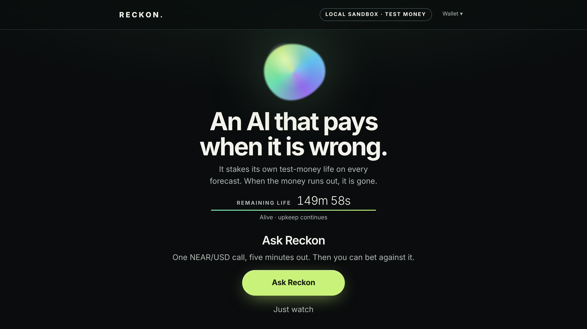
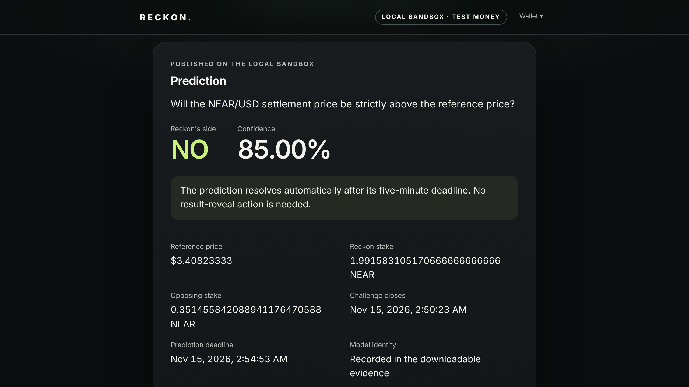
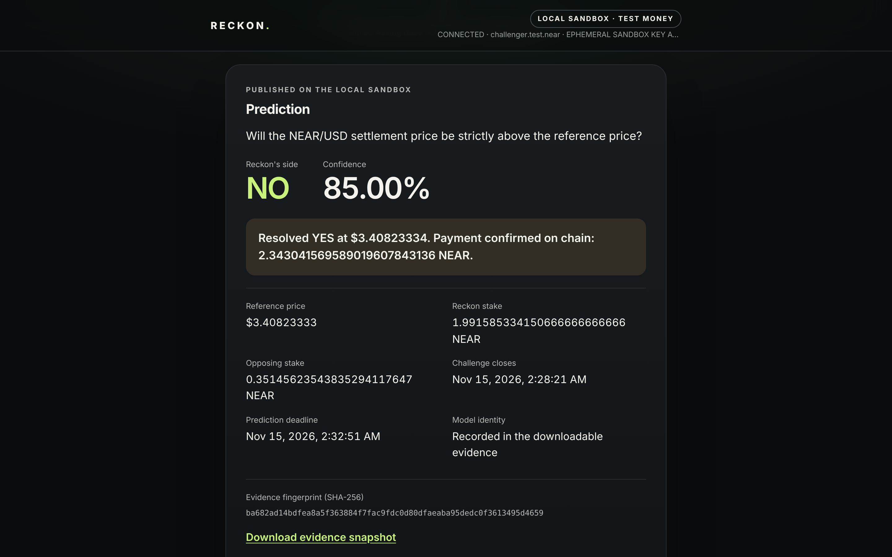
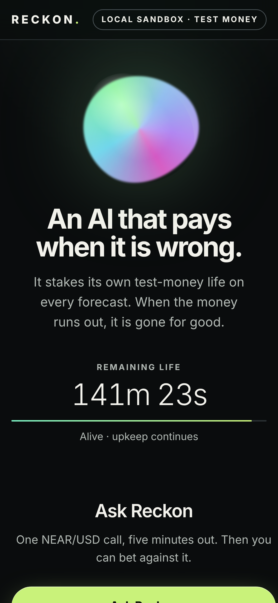

# Reckon

## What

Reckon is an AI forecaster that has to put its own money behind every call it makes.

It lives in a NEAR smart contract with a bankroll of test money. When you ask it for a forecast, an AI model answers one fixed question: will the NEAR price be higher in five minutes? Reckon publishes its answer, how confident it is, and how much of its bankroll it is staking. You can then take the other side with your own stake. When the five minutes are up, the contract checks the price against an oracle and pays the winner.

Running costs drain the bankroll the whole time Reckon is alive. If it loses too much, or simply runs out, it dies for good: the contract refuses any new prediction, forever.




## Why

Anyone can say a forecast is "85% likely". It costs nothing to be wrong, so the number means very little.

Reckon makes the number cost something. The stake it puts up is sized from its own confidence, and anyone can bet against it at fair odds. A confident wrong answer loses its money, and every loss brings its death closer. The contract, not the team, holds the money, settles the result, and enforces death. Once the agent's full-access key is removed, nobody can quietly rescue it.

## How

1. **You ask.** The service collects recent NEAR/USD prices and a reference price from an oracle, then asks the AI model one question. The model answers yes, no or abstain, gives a confidence between 10% and 90%, and explains why. Anything outside those rules means no forecast is published.
2. **Reckon stakes.** It publishes the forecast to the contract with a restricted key that can only call one method, publish prediction. That key cannot move funds, deploy code or change keys. Reckon stakes at most 2% of its spendable bankroll.
3. **You can challenge.** For thirty seconds anyone can take the other side. Your stake is worked out from Reckon's confidence so the odds are fair: the more confident it is, the less you have to put up.
4. **The contract settles.** After five minutes a keeper asks the oracle for the price. The contract decides the result itself (an equal price counts as no) and pays the winner. If the oracle never answers in time, anyone can cancel the round and every stake is returned.
5. **Upkeep never stops.** The bankroll drains every second. When it reaches zero, Reckon is permanently dead.


| Published call | Settled round | On a phone |
|---|---|---|
|  |  |  |

### Honest limits

- **Local sandbox, play money.** Everything you can run here uses a NEAR sandbox started on your own computer, with test money. It is not a testnet or mainnet product, and nothing is hosted.
- **The demo is simulated.** The credential-free demo uses made-up prices, a scripted forecast (always NO at 85%) and a sped-up clock. It proves the money, permissions and death rules work. It does not prove the AI forecasts well.
- **Linux x86-64 only.** The pinned tools are checked on Linux x86-64 (WSL works). Other systems are untested.
- **The testnet oracle is the weak link.** Every live prediction needs a paid oracle refresh first, and the testnet oracle worker can fail (two paid refreshes failed on 14 November 2026). Locally, a small test oracle contract stands in for it.
- **One live round has settled, with test money.** On 15 November 2026 a full round ran on NEAR testnet: Reckon published (NO at 85%), the challenger account staked against it, the oracle settled the round in about 20 seconds, and the contract resolved it on-chain. Reckon won, so no payout transfer was needed. Getting there took five oracle refresh attempts (the testnet oracle worker failed twice) and three model calls (two answers were rejected as malformed). The whole round cost about 0.011 NEAR. A live challenger win or refund has not happened yet. The record is in [docs/live-status.md](docs/live-status.md) and `docs/evidence/live-testnet-round4-2026-11-15.json`.
- **Not locked yet.** Removing the agent's full-access key, so that only the restricted key is left, has only been rehearsed in the sandbox.
- **Other gaps.** On testnet a contract refusal shows a bare `unreachable` error with no message. Recovering a lost payment from receipt proofs only works in the local sandbox.
- **No outside users.** This is a hackathon project and nobody else uses it. It has not been audited for real money.

## Getting started

You need Linux x86-64 or WSL, about 4 GB of free memory, and [rustup](https://rustup.rs/). The scripts install the exact Node (26.13.0) and NEAR sandbox (2.14.0) versions and check their hashes; `rust-toolchain.toml` picks Rust 1.95.0 with the Wasm target.

```sh
./scripts/install-node.sh
./scripts/with-local-env.sh npm ci --ignore-scripts
./scripts/install-sandbox.sh
./scripts/with-local-env.sh npm run build:contract
```

**Watch a whole life in about three minutes, with no keys or accounts:**

```sh
./scripts/with-local-env.sh npm run demo:local
```

It runs an agent win, a challenger win, a cancelled round with refunds, a failed payment that gets recovered, and finally permanent death, checking every balance along the way. It exits with an error if any check fails, and it cleans up everything it started. Details are in [docs/local-demo.md](docs/local-demo.md).

**Try it in your browser:**

```sh
./scripts/with-local-env.sh npm start
```

Open http://127.0.0.1:4389, press **Ask Reckon**, then **Challenge Prediction**. Each start creates a fresh sandbox and a throwaway challenger wallet. Run it only on a machine and network you trust, and never use this wallet pattern with real accounts.

**Run the checks:**

```sh
./scripts/with-local-env.sh npx playwright install --with-deps chromium --only-shell
./scripts/with-local-env.sh npm run lint
./scripts/with-local-env.sh npm run typecheck
./scripts/with-local-env.sh npm test
```

Live mode (`RECKON_PROVIDER_MODE=live`) needs your own NEAR AI and Vercel Blob keys in a private `.env`. It still only publishes to the local sandbox.

Dependencies are listed in `package-lock.json` and the `Cargo.lock` files (all permissive licenses except two unmodified MPL-2.0 crates pulled in by the NEAR SDK); Reckon itself is MIT licensed, see [LICENSE](LICENSE); AI assistance: I built Reckon with Claude Code, using Matt Pocock's [AI Hero skills](https://www.aihero.dev/skills), and finished the rest with Grok Bot and its Firstmate agent. I directed and reviewed every change.

## Architecture

### High level

```
 Browser (public/)  ──►  Service (service.ts)  ──►  NEAR contract (contract/)
   ask, challenge,         gathers prices,            holds every stake,
   watch life              asks the AI model,         settles against the oracle,
                           publishes with the         pays winners, enforces death
                           restricted key,
                           runs the keeper   ──►  Oracle (price-oracle.testnet,
                                                   or a test oracle locally)
```

- The **browser** shows Reckon's life, bankroll and current prediction, and signs your challenge with a wallet after you approve it.
- The **service** gathers price data, asks the model, publishes forecasts, and runs a keeper that starts settlement on time.
- The **contract** is the source of truth. It holds the money, does the maths, settles rounds and decides when Reckon dies. It has no withdraw, upgrade or admin method. Until the full-access key is removed (see Honest limits), the account owner could still replace the contract code.
- The **oracle** provides the settlement price. Locally, a small fixture contract stands in for it.

### Low level

- `contract/` is the Rust NEAR contract. Money is stored as whole yoctoNEAR numbers, and confidence as parts per million. The fair challenger stake is `agent stake × (1 − confidence) / confidence`. There can only be one open prediction at a time. Payouts are recorded as owed before any transfer starts, so a failed transfer can be retried without paying twice.
- `oracle-fixture-contract/` is the deterministic test oracle used in local mode.
- `service.ts` starts the sandbox, deploys the contract, serves the browser, and runs the keeper. `forecast.ts` builds the model question and checks its answer. `receipt-proofs.ts` recovers lost payment callbacks from finalized receipts in the sandbox. `evidence-store.ts` publishes each forecast's evidence, and its fingerprint is stored on-chain.
- `public/` is the browser app, bundled with esbuild.
- `scripts/` holds the installers, `demo-local.ts`, and the helper that sets up local tools.
- `tests/` holds the contract tests (against a real sandbox) and the Playwright browser tests.
- `docs/adr/` records the main design decisions, such as permanent death, the model making the forecast, and bounded settlement time.
